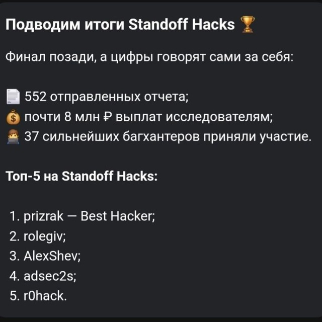
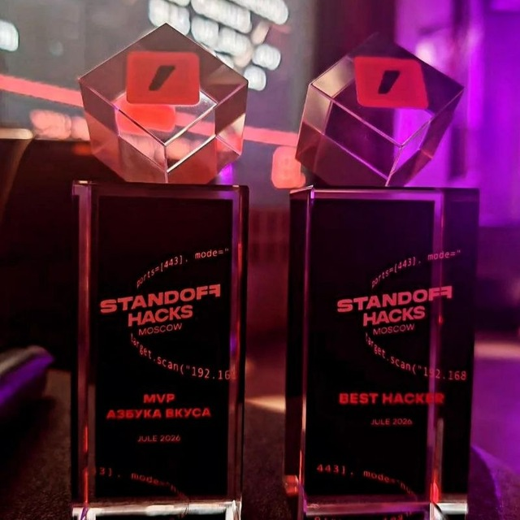
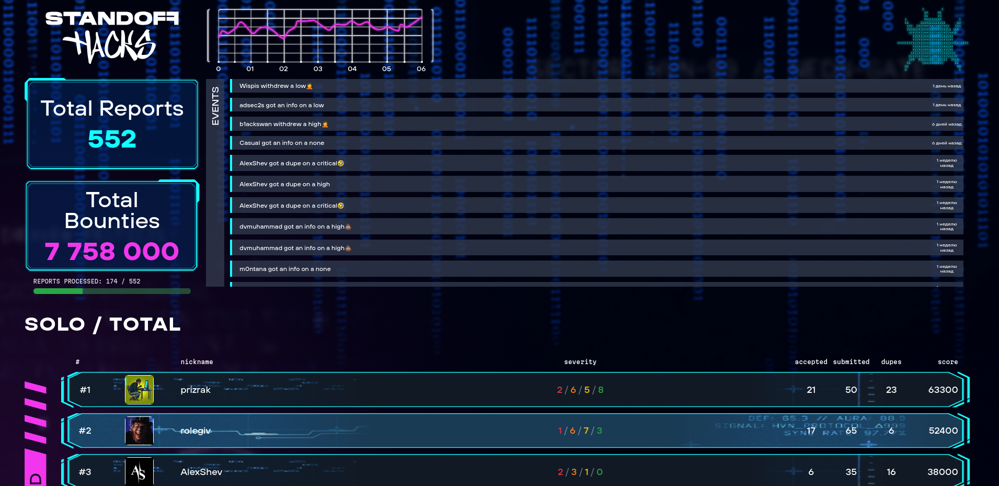

<div align="center">

# Prizrak

### Security Researcher · Web & API Pentester · Bug Bounty Hunter

[](https://standoff365.com/profile/prizrak/)
[](https://standoff365.com/profile/prizrak/)
[](https://github.com/jjjeanmax)

<sub>Finding weaknesses before they become incidents.</sub>

</div>

---

## `whoami`

```json
{
  "handle": "prizrak",
  "name": "Jean Maxime",
  "focus": ["Web Security", "API Security", "Bug Bounty", "Security Automation"],
  "certifications": ["OSWE", "eWPTXv2", "CWEE", "Mail.ru Web Security Analysis"],
  "currently": "Researching, building tooling, and responsibly reporting security issues"
}
```

## 🏆 Standoff Hacks — July 2026

> **1st place · Best Hacker** at **Standoff Hacks**, a Russian bug-bounty competition.

| Event scorecard | Result |
| :-- | --: |
| Place | **#1 / Best Hacker** |
| Accepted reports | **21** |
| Submitted reports | **50** |
| Duplicates | **23** |
| Score | **63,300** |
| Additional recognition | **MVP — Azbuka Vkusa** |

<p align="center">
  <a href="assets/standoff-hacks-july-2026-results.jpg"></a>
  <a href="assets/standoff-hacks-july-2026-awards.jpg"></a>
</p>

<details>
  <summary><b>Open the competition scoreboard</b></summary>
  <br />
  
</details>

## Research profile

- 🔎 Public bug-bounty profile: [standoff365.com/profile/prizrak](https://standoff365.com/profile/prizrak/)
- 🛡️ Primary interests: application security, attack-surface analysis, authentication, authorization, and business logic
- ⚙️ I build practical security tooling for repeatable, evidence-driven testing
- 🤝 I value responsible disclosure and clear remediation guidance

## Certifications

`OSWE` · `eWPTXv2` · `CWEE` · `Mail.ru Web Security Analysis`

---

<div align="center">
  <i>Authorized research only. Build carefully, test responsibly, report clearly.</i>
</div>
